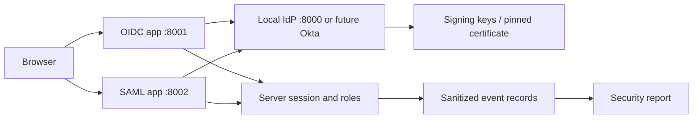

# Architecture

## Objective and environment

Demonstrate a fictional enterprise's federated sign-in and role enforcement with two independent relying applications. The finance portal uses OIDC; a legacy portal uses SAML. The provider is a loopback fixture for automated evidence; Okta is the planned external provider. No real user or tenant was supplied.

Trust boundaries: browser is untrusted; front-channel parameters need correlation; back-channel token exchange uses a verifier and client authentication; signatures bind claims to trusted issuer keys; application role mapping controls access after authentication. Loopback HTTP is a lab exception; external deployment requires HTTPS. Each app has its own cookie name, secret, and session store.

OAuth 2.0 grants delegated authorization through access tokens. OIDC adds an identity layer and ID tokens. SAML conveys authentication and attributes through XML assertions. An ID token is not an API access token. Neither a valid signature nor successful login grants application privileges by itself.

## Implementation and decisions

Use Authlib for OIDC protocol state/nonce/PKCE and token verification; use SignXML for cryptographic XML verification and a restricted SAML bearer-assertion profile for the fixture. Use PyJWT for isolated validation tests. The synthetic provider issues temporary keys per process, automatic fixture identities, and a one-time authorization code. It is not an authentication product or OpenID certification target.

## Validation and evidence

See tests/results.txt for separate OIDC/SAML round-trips; security-report.json for measured checks. Pending external work is explicitly listed in PROJECT-STATUS.md. Diagrams for each protocol are in docs/flows.md. Troubleshooting: ports must be free and issuer/callback strings must match exactly.

