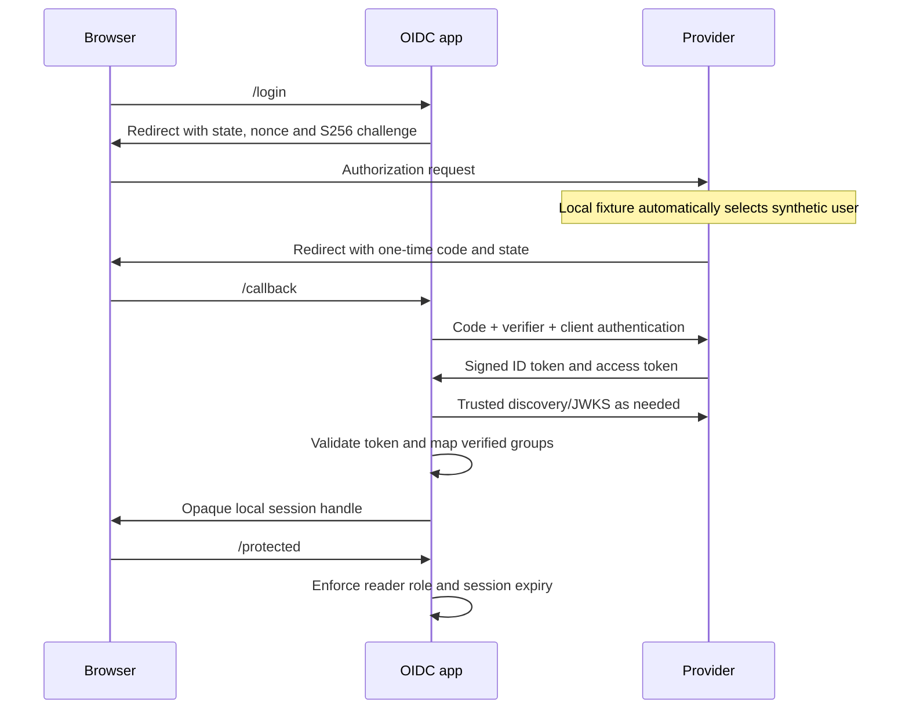

# Protocol flows

## OIDC Authorization Code + PKCE



## SAML SP-initiated sign-in

```mermaid
sequenceDiagram
 participant B as Browser
 participant SP as SAML app
 participant I as Provider
 B->>SP: /login
 SP->>SP: Store pending request ID and deadline
 SP->>B: HTTP Redirect with DEFLATE/base64 AuthnRequest
 B->>I: /saml/sso
 I->>B: Form containing signed Assertion in Response
 B->>SP: HTTP POST to ACS
 SP->>SP: Correlate request, pin certificate and verify signed element
 SP->>SP: Validate subject, issuer, audience, times and replay
 SP->>B: Local session; redirect to protected page
```
